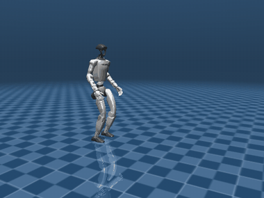
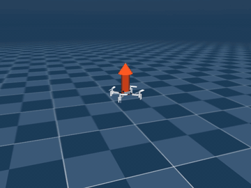
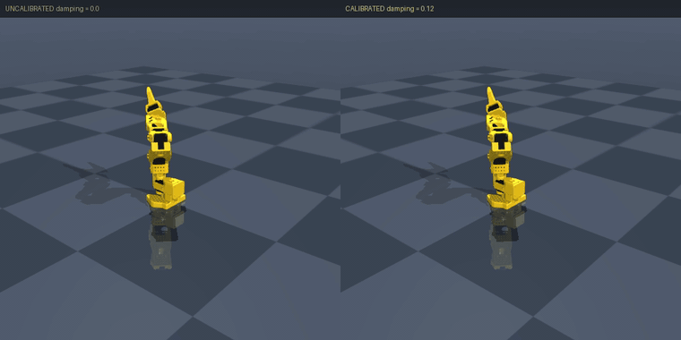
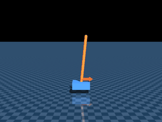

# Jaxterity

**JAX-native robotics — from a URDF to a calibrated, deployable robot model.**

[](https://github.com/machinavitalis/jaxterity/actions/workflows/ci.yml)
[](https://pypi.org/project/jaxterity/)
[](https://pypi.org/project/jaxterity/)
[](https://github.com/machinavitalis/jaxterity/blob/main/LICENSE.md)

<div align="center">

<table>
<tr>
<td align="center"><br><b>Unitree G1 — humanoid</b><br><sub>whole-body locomotion</sub></td>
<td align="center"><br><b>Crazyflie — quadrotor</b><br><sub>differentiable flight · vmap'd swarms</sub></td>
</tr>
</table>

<br>
<sub>SO-101 arm · uncalibrated (overshoots)&nbsp;&nbsp;‖&nbsp;&nbsp;calibrated to real telemetry (settles)</sub>

</div>

Jaxterity turns a robot description (URDF/MJCF) into a *differentiable*
simulation, calibrates that simulation against real hardware telemetry so it
matches the physical machine, and carries one attested model all the way to
embedded deployment. The model you tune is the model you ship — no sim-to-real
model swap in the middle.

It is built on [MJX](https://mujoco.readthedocs.io) (GPU/TPU MuJoCo) for
articulated dynamics and on the
[Jaxonomy](https://github.com/machinavitalis/jaxonomy) simulation engine, so
every robot is a JAX program: `jit`-compilable, `vmap`-batchable, and
differentiable end to end.

## Why it's different

- **One model, sim to silicon.** A calibrated `Robot` hands off to
  [Jaxility](https://github.com/machinavitalis/jaxility) (the deployment
  compiler, forthcoming) as a single artifact. You design, calibrate, and
  deploy the *same* dynamics — not a sim model and a separate shipped model
  that quietly disagree.
- **Calibrated to your actual unit.** System identification fits the model to
  real telemetry — per-joint friction and damping, per-servo thermal behaviour,
  battery sag — so the simulation tracks the physical robot, down to the serial
  number. On a real SO-100/LeKiwi arm the identified plant predicts joint torque
  16–45% better than the raw URDF on held-out data.
- **Differentiable through contact.** Calibration, control design, and learning
  all run on one differentiable model. Forward-mode autodiff differentiates
  *through* MJX's joint-limit and contact solver — where naive reverse-mode
  cannot — so you get exact parameter sensitivities for free.
- **Predictive self-check.** A per-unit digital twin forecasts off-body state a
  body-only physics model never sees — servo heat, bus voltage — and vetoes a
  command that would cook a servo or brown out the battery *before* it is sent,
  naming the binding constraint and the time to breach. On a veto, a per-unit
  reflex takes over: an execution-time filter that clamps any policy's torque to
  what *this* unit's measured limits allow, and brakes to rest through the same
  barriers.
- **Ask before you act.** The same twin answers questions instead of only
  judging commands — "does this hold overheat?", "which lift keeps the most
  tip-over margin?" — with per-constraint margins and the spread those margins
  have across the unit's own fitted uncertainty, so you can tell a physical
  "no" from a fit too loose to say. Callable from an LLM planner over MCP.
- **Attested provenance.** Every calibrated model carries a content-hash
  *attestation handle*: a stable fingerprint over its structure and fitted
  parameters, so you can prove which model produced which controller.

## What's in the box

- **Import** — URDF/MJCF → a `Robot` with an MJX-backed differentiable model.
- **Calibrate** — forward-mode system identification of inertial, friction, and
  actuator parameters from telemetry, with covariance and provenance.
- **Devices** — calibrated actuator and sensor models (DC motor, servo, BLDC,
  harmonic drive, series-elastic; IMU, encoder, force/torque) you can fit and
  validate.
- **Control** — whole-body control primitives and a layered, agent-friendly
  "code-as-policies" API (raw torque → skills → high-level goals).
- **Twins & safety** — per-unit attested digital twins, a predictive self-check
  co-processor, a safety monitor (thermal / bus-voltage / torque limits), and
  pre-flight policy checks.
- **Zoo** — ready-to-run reference robots (cartpole, SO-100/SO-101 arm,
  Crazyflie, Unitree G1) with import + dynamics goldens.

## Where it sits

```
Jaxonomy            Jaxterity                       Jaxility
(simulation     →   (this library:              →   (deployment compiler,
 engine)            robotics + calibration)         Arm SoC + attestation)
```

Jaxterity imports Jaxonomy for the general-purpose simulation primitives
(`Diagram`, `simulate`, solvers, autodiff) and never re-implements them; it adds
everything robot-specific on top.

## Install

```bash
pip install jaxterity            # core
pip install "jaxterity[all]"     # optional extras (render, data, MCP, …)
```

Or from a clone, for development:

```bash
pip install -e ".[all,dev]"      # contributors / CI
```

Requires Python 3.11+ and pulls in
[Jaxonomy](https://github.com/machinavitalis/jaxonomy) (the simulation engine)
from PyPI. The render/zoo helpers use MuJoCo; no GPU is required to run the
examples.

## Quickstart

End-to-end system identification on a real arm —
[`examples/sysid_so101.py`](https://github.com/machinavitalis/jaxterity/blob/main/examples/sysid_so101.py): load the open-source
SO-101 URDF, simulate it under gentle excitation to generate telemetry, then
recover unknown joint damping from that telemetry with forward-mode autodiff
(differentiating *through* MJX's joint-limit constraint solver), and emit a
calibrated, attested `Robot`.

```bash
pip install -e ".[mujoco]"
python -m examples.sysid_so101
```

### The whole pipeline in one file

[`examples/nanojaxterity.py`](https://github.com/machinavitalis/jaxterity/blob/main/examples/nanojaxterity.py) is the Karpathy-style
end-to-end demo — top to bottom in a single readable file, no hidden machinery:
load the cartpole with its committed calibration, build a fast functional MJX
environment, train a small self-contained PPO agent to balance the pole, and
check the result against a committed golden.

<div align="center"></div>

```bash
python -m examples.nanojaxterity
```

Deployment to embedded targets — the final leg of *URDF → calibrate → train →
ship* — is handled downstream by
[Jaxility](https://github.com/machinavitalis/jaxility).

For a guided, visual walkthrough with MuJoCo animations, see the notebook
[`examples/calibrate_so101.ipynb`](https://github.com/machinavitalis/jaxterity/blob/main/examples/calibrate_so101.ipynb), and the
[tutorials index](https://github.com/machinavitalis/jaxterity/blob/main/examples/TUTORIALS.md) for one worked example per robot. A
short mental model of how MJCF, MJX, and Jaxonomy fit together is in
[Jaxterity in one picture](https://github.com/machinavitalis/jaxterity/blob/main/docs/jaxterity-in-one-picture.md).

## Maturity

**1.0 covers a stable core:** URDF/MJCF import, MJX-backed differentiable
dynamics, forward-mode system identification, the reference zoo, the attestation
handle, and the per-unit twin + predictive self-check stack — each backed by
CI-green evidence in [`CLAIMS.md`](https://github.com/machinavitalis/jaxterity/blob/main/CLAIMS.md)
(some fit from *real* hardware telemetry).

**Some subsystems are still filling in** and are best treated as preview: the
whole-body-control stack (task DSL, centroidal primitives, gait scheduler, and
the dynamics-consistent floating-base solve are here; friction cones and a
closed-loop walking demo are not), the turnkey sysid-recipe catalogue, and
complete actuator/sensor family coverage. Embedded deployment is owned by Jaxility, not this repo. Each of
these is written down in
[`KNOWN_GAPS.md`](https://github.com/machinavitalis/jaxterity/blob/main/KNOWN_GAPS.md),
kept symmetric with the claims ledger. Read both before depending on a surface.

## Development

```bash
bash scripts/check.sh   # ruff lint + format, mypy, pytest
```

## License

MIT — see [LICENSE.md](https://github.com/machinavitalis/jaxterity/blob/main/LICENSE.md).
