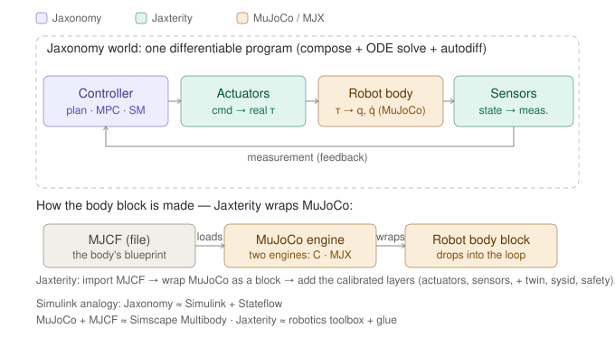
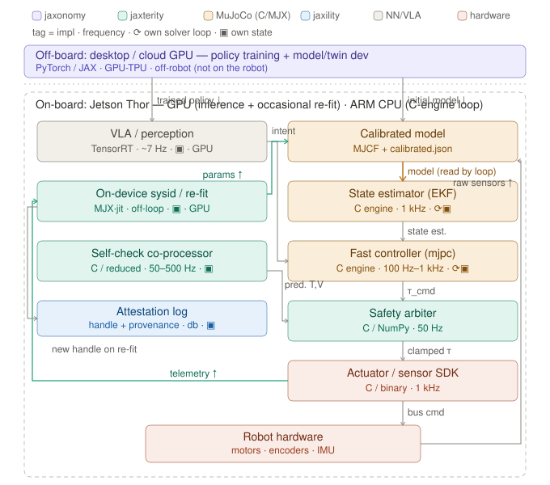

# Jaxterity in one picture

*How MJCF, MJX, and Jaxonomy fit together — a mental model for new users.*

If you've used block-diagram simulators (Simulink / Simscape / Stateflow), or
you've trained robot policies in MuJoCo, this page gives you the one mental model
that makes the rest of Jaxterity click.

## The one idea

**Jaxterity is not a new physics engine.** It's the adapter that drops a MuJoCo
robot body into a differentiable block-diagram world (Jaxonomy) as a single
*plant block*, then surrounds it with the robotics-specific pieces — calibrated
actuators and sensors, a per-unit twin, system identification, and a safety layer
— so you're simulating and controlling *your specific robot*, not a generic one.

> MuJoCo models a robot. Jaxterity makes the model *your* robot, and gives the
> rest of the stack (control, estimation, deployment) one consistent handle on it.

## The starting point: a robot body is just an ODE

You already know that a block diagram ultimately defines an ODE, `ẋ = f(x, u)`,
that a solver integrates. A robot's body is no different: its state is the joint
positions and velocities `x = (q, q̇)`, its input is the joint torques `τ`, and
its dynamics are `ẋ = f(x, τ)`.

The catch: for a robot with many joints and contact, you would *never* hand-wire
that `f` out of feedforward/feedback blocks. The multibody equations of motion
(the mass matrix `M(q)`, Coriolis terms, contact forces from an iterative solver)
are enormous, and contact is non-smooth. **Computing that `f` is exactly what
MuJoCo exists for.** So instead of building the body, you let MuJoCo build it and
you treat it as one block.

## The three pieces

- **Jaxonomy** — the JAX-native block-diagram engine: compose blocks into systems,
  solve the resulting ODE/DAE, and differentiate through the whole thing. This is
  your Simulink/Simscape/Stateflow layer.
- **MJCF** — a robot body's *blueprint*: an XML file describing the kinematic tree
  (links, joints), inertias, collision geometry, and generic actuators. (URDF
  imports into the same role.)
- **The MuJoCo engine** — what actually computes `ẋ = f(x, τ)` (forward dynamics
  with contact) from an MJCF. It comes in **two forms of the same physics**: the
  **C engine** (canonical, low-latency — the real-time evaluator that runs onboard)
  and **MJX** (MuJoCo re-implemented in JAX — differentiable and `jit`/`vmap`-able,
  the evaluator for *off-loop* fitting, training, and optimization). Same model,
  same `f`; you pick the evaluator that fits the job (see *Runtime* below).
- **Jaxterity** — the wrapper. It imports the MJCF, wraps the body dynamics as a
  Jaxonomy block, and adds the layers Jaxonomy doesn't ship: calibrated actuators
  and sensors, system identification, the per-unit twin, and the self-check /
  safety layer.

## The picture

Read the top row as the control loop, left to right and back:

1. **Controller** (a Jaxonomy block diagram, an MPC, a policy, a state machine)
   emits a command.
2. **Calibrated actuators** turn that command into the *real* delivered torque `τ`
   — accounting for friction, the torque constant, thermal effects, supply
   voltage. (A generic MuJoCo actuator skips most of this.)
3. **Robot body** — the plant block. Its dynamics are MuJoCo's (`τ → q, q̈`,
   integrated to the new state `(q, q̇)`, contact and constraints included).
   Off-loop (sysid, training) it's evaluated by MJX; on the robot it's evaluated by
   the C engine — same physics, different engine (see *Runtime* below).
4. **Calibrated sensors** turn the true state into a *measured* one — with noise,
   bias, latency — which feeds back to the controller / estimator.

Everything in that loop lives **inside Jaxonomy**, so the whole thing is one
program the engine can compose, solve, and differentiate end to end.

## The robot body is just one block

You never see the body's internals as wired sub-blocks. It's a single
Jaxonomy system that exposes its dynamics through `Robot.functional_dynamics()`
— a fast `jit`/`vmap` function `f(state, τ) → dstate`. Everything *around* it
(controller, actuators, sensors, estimator, state machine) is ordinary Jaxonomy
composition, so your existing mental model applies unchanged: the robot body is
just one (very dense) plant block you didn't have to build by hand.

> Two evaluators, one model. `Robot.functional_dynamics()` is the **MJX (JAX)**
> path — differentiable and batchable, used for sysid, training, and optimization
> *off* the control loop. On the robot, the **same body** (same MJCF, same fitted
> parameters) is evaluated by the **C engine** in the real-time loop, where MJX's
> batched/JIT design is the wrong fit. Same physics, two engines — see *Runtime:
> where each piece runs* below.

## Actuators and sensors: the brackets that make it real

A bare MuJoCo model is a *nominal* robot — datasheet-class numbers. The calibrated
actuator and sensor blocks are what bracket the body and make it behave like the
actual device:

- **Actuators**: command → real torque, through a motor model with viscous and
  Coulomb friction, a torque constant, and (where relevant) servo thermal and
  battery/bus-voltage effects.
- **Sensors**: true state → measured signal, with the noise, bias, and latency a
  real encoder/IMU/force sensor introduces.

These are ordinary Jaxonomy blocks. They're what turn "a robot" into "this robot."

## The Twin: your specific unit

A **Twin** is the per-unit bundle: a calibrated robot body + its calibrated
actuators/sensors + off-body physics (thermal, battery) + the unit's identity.
Two robots with identical parameters but different serial numbers are different
twins. A twin carries an **attestation handle** — a hash of its model and
parameters — so a result can be tied to exactly the unit it was produced on.

The shipped `calibrated.json` for a model starts as a nominal placeholder and
becomes a real fit once you calibrate against that unit's telemetry (see
[`CLAIMS.md`](../CLAIMS.md) and [`KNOWN_GAPS.md`](../KNOWN_GAPS.md) for what is and
isn't calibrated today).

## Why JAX: one differentiable program

Because both MJX and Jaxonomy are JAX, the entire loop — controller → actuators →
body → sensors — is a single differentiable program. That's the property that
makes two hard things tractable:

- **System identification**: fit the actuator/body parameters by gradient descent,
  with `jax.grad` flowing through the simulation, instead of guessing or hand-tuning.
- **Control optimization**: optimize a trajectory or a controller *through* the
  physics, not just by sampling it.

## Runtime: where each piece runs

The block diagram above is the *logical* model. At runtime the pieces land on
different compute, and the rule the conceptual picture hides is this: **the
real-time control loop runs on the C engine (CPU), not MJX.** MJX/JAX is
throughput-optimized — a single step is *slower* than the C engine, with JIT/graph
warmup — so it's the right tool for batched off-loop work (training, system
identification, optimization) and the wrong tool for a deterministic kHz loop. The
onboard loop is the **C engine** (e.g. `mjpc` for MPC, plus an EKF-style state
estimator); MJX stays *off the loop*.

Here is a GPU-class robot (a Jetson Thor). Training happens **off-board**; the
robot's GPU runs the VLA and *occasional* re-fit; the ARM CPU runs the real-time
C-engine loop. Re-fit writes the calibrated model; the loop reads it.

Reading it: off-board provisions the trained policy and initial calibrated model;
the **state estimator → fast controller → safety arbiter → actuator SDK** chain is
the real-time loop on the CPU; the **self-check co-processor** forecasts servo heat
/ bus voltage and feeds the safety arbiter's veto; **on-device re-fit** turns
logged telemetry into updated parameters and a new **attestation handle** (a hash
of the model + parameters that uniquely identifies this calibration).

On a CPU-only robot (e.g. a Raspberry Pi) the split is sharper: the heavy MJX twin
and sysid move **off-board** entirely, and only NumPy/C runs on the robot — a
compiled controller, a reduced co-processor, capture, and the SDK — with three
channels crossing the boundary (signed controller down, model params down,
telemetry up).

> Maturity note: on-device MJX re-fit is plausible on a GPU robot but not built
> today; the validated shape so far is the CPU/split case (a reduced NumPy
> co-processor on real silicon). Read the GPU diagram as where this goes when the
> compute allows, not what ships today — see [`CLAIMS.md`](../CLAIMS.md).

## Why — and when — calibration matters

It's worth being honest up front: **calibration is not what makes a robot
move.** Feedback control and domain randomization already absorb a lot of
per-unit variance. A well-tuned feedback loop rejects model error in real time,
and a policy trained across randomized dynamics is built to run on any unit
without per-unit tuning. For forgiving, well-margined tasks — walking, balancing,
gross pick-and-place — that combination is often enough, and an entire fleet can
run the same controller and look identical doing it.

So where does a calibrated, per-unit model actually earn its place? Two
situations.

**1. When feedback and randomization can't bail you out.** Per-unit variance
isn't uniform — it concentrates in the hard-to-model places (joint friction,
backlash, gearbox losses, thermal behavior), while link inertias and geometry
barely vary (same parts). That variance starts to bite whenever the controller
*relies on the model being right*:

| Feedback + randomization handle it | A calibrated per-unit model matters |
|---|---|
| Forgiving, well-margined motion (walk, balance, gross grasp) | Model-based / feedforward / low-gain control (MPC, computed-torque, compliant) |
| Tracking a shared reference with margin | Precision and contact-rich manipulation (small error budget) |
| A fleet running one policy, looking identical | Operating near torque/thermal limits (no room for a conservative margin) |
| — | Energy efficiency, and safety / failure prediction (heat, brownout) |

The right-hand column is where this stack lives: the model-based, precision,
near-limit, efficiency, and safety regimes — not the forgiving feedback-dominated
ones.

**2. When the robot changes and nothing else adapts.** This is the part no other
mechanism covers. Feedback gains, the randomization-trained policy, and the
factory calibration are all set *once*, at deployment, and never updated. But a
robot drifts: friction climbs, backlash grows, a motor weakens, a battery ages.
The day-one solution slowly stops fitting — and nobody re-tunes. Randomization
buys a fixed envelope; wear eventually walks the robot toward its edge, and
performance erodes (or safety margin quietly disappears) before anyone notices. A
model that's **kept current** — re-identified from the unit's own telemetry as it
ages — is the answer, and it's why the per-unit twin is a *lifecycle* thing, not a
one-time fit.

Short version: feedback and randomization make a robot *move* robustly;
calibration makes it *precise, efficient, safe, and trustworthy over its life* —
especially as it wears.

## System identification: three flavors (and where Jaxterity sits)

"Sysid" means different things depending on what's unknown. It helps to place them
on a white-box ↔ black-box spectrum:

| What's unknown | Method | Tool in this stack |
|---|---|---|
| The **parameter values** of a known model | Differentiable parametric fit (the equations are MuJoCo's; fit friction, Kₜ, inertia) | **Jaxterity sysid** — the default for a robot body |
| A **missing term** in a known model | Learned correction inside the dynamics (e.g. drag), trained through the solver | Jaxonomy `NeuralDAEBlock` (UDE-style) |
| The **equations themselves** | Sparse regression over a library of candidate terms | Jaxonomy SINDy / symbolic regression |

For an articulated robot you almost always want the **parametric** end: the
structure is known physics (that's what MuJoCo encodes), so you fit parameters —
far more data-efficient and interpretable than rediscovering the equations, and it
respects constraints and contact structure. Equation-discovery methods like SINDy
earn their keep elsewhere — *unmodeled*, low-dimensional dynamics (soft robots,
aerodynamics, unusual friction laws, residual effects on top of a nominal model) —
and the three approaches compose: physics model + a learned or discovered residual.

> Note: MuJoCo 3.5 ships a first-class system-identification toolbox for fitting
> model parameters. Jaxterity builds *on* that rather than competing with it — its
> focus is the per-unit twin, the calibrated actuator/sensor component models
> (servo thermal, battery) the toolbox doesn't cover, the self-check/safety layer,
> and deployment. The fit is the starting point, not the product.

## What Jaxterity is *not*

- Not a replacement for MuJoCo — it *uses* MJX for the body dynamics.
- Not a re-implementation of physics — the equations of motion stay in MJX.
- Not robot-specific magic — it's structure (from MJCF), calibration (from your
  telemetry), and a lifecycle around them.

## Where to go next

- [`examples/sysid_so101.py`](../examples/sysid_so101.py) — end-to-end system
  identification on an open-source arm.
- [`examples/calibrate_so101.ipynb`](../examples/calibrate_so101.ipynb) — the
  calibration workflow.
- [`AGENTS/CONTEXT.md`](../AGENTS/CONTEXT.md) — the full architecture and
  conventions.
- [Jaxonomy](https://github.com/machinavitalis/jaxonomy) — the simulation engine
  underneath.
