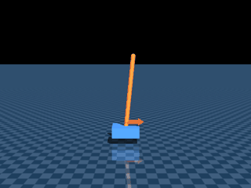

# Jaxterity tutorials

Worked examples of jaxterity computations — start with the single-file
end-to-end demo below, then the four per-robot notebooks, each culminating in an
**animated MuJoCo render**. The dynamics run on jaxterity's mesh-free zoo models
(differentiable MJX plants); the render animations are post-hoc-rendered through
full-mesh [MuJoCo Menagerie](https://github.com/google-deepmind/mujoco_menagerie)
models (vendored under `assets/`) by the shared bridge
[`_robot_render.py`](_robot_render.py).

Each notebook embeds its outputs, so it renders on GitHub/nbviewer without
re-running. Open the matching `media/tutorial_*.gif` for the showcase animation alone.

Below the render notebooks sit three deeper tracks: a six-part **locomotion**
series (capture point → embedded C), the **calibration** notebooks, and the
**LeKiwi** mobile-manipulation set.

## Start here — the end-to-end demo

[`nanojaxterity.py`](nanojaxterity.py) (with a guided
[`nanojaxterity_tutorial.ipynb`](nanojaxterity_tutorial.ipynb)) is the
single-file tour of the whole pipeline: a calibrated cartpole → a fast
functional MJX environment → a self-contained PPO loop → a balanced pole,
checked against a committed golden. It's the best first read for *how a
Jaxterity robot becomes a trained policy.*

```bash
python -m examples.nanojaxterity
```



Deployment to embedded targets is handled downstream by Jaxility; this demo
stops at the trained policy.

## Per-robot render notebooks

The notebooks below each culminate in an **animated MuJoCo render** of a
jaxterity computation.

| Tutorial | Robot | What it shows | Showcase animation |
|---|---|---|---|
| [`tutorial_unitree_g1.ipynb`](tutorial_unitree_g1.ipynb) | Unitree G1 (29-DoF humanoid) | **Kinematics → dynamics → calibration → deployment, and the wall in the middle.** `jax.jacobian` through MJX kinematics *is* the kinematic Jacobian (free, machine-precision), and `vmap` solves 64 IK reaches at once. Then dynamics: `jacfwd` differentiates `mjx.step`, while `jax.grad` **cannot** — the constraint solver is a `while_loop` — which is why identification is forward-mode LM, and why MuJoCo can't be lowered to C. `LoopbackLink` plants parameters and `active_identify` recovers them (noiseless *and* noisy). Closes with `generate_dynamics` emitting the deployable model in **7 smooth CasADi primitives**. | the G1 reaches its arm to a target sphere |
| [`tutorial_crazyflie.ipynb`](tutorial_crazyflie.ipynb) | Crazyflie 2.0 (nano-quadrotor) | **Differentiable, vmappable flight.** The thrust+moment wrench → free-base generalized force is pure JAX; `jax.jacobian` yields the linearized `A,B` an LQR/MPC would use; one jitted controller flies a 64-drone swarm. | the quadrotor carves a figure-8 with a live thrust arrow |
| [`tutorial_nanolerobot.ipynb`](tutorial_nanolerobot.ipynb) | SO-100 arm (LeRobot ecosystem) | **One calibrated model, sim → dataset → policy.** The calibrated MJX env is `jit`/`vmap`-able, exports to the open **LeRobotDataset** format, and a cloned policy closes the loop on the *same* model that deploys. | the arm sweeps through held-out goal poses under the cloned policy |
| [`tutorial_rerun_streaming.ipynb`](tutorial_rerun_streaming.ipynb) | any robot (diagnostics) | **Robot-agnostic observability.** One FK-driven `RobotRerunLogger` streams 3D link transforms + a skeleton + per-joint signals for the arms, the quadrotor, *and* the humanoid — no per-robot drawing code. | the G1 runs a choreography with its signals inspected alongside |

## Calibration — method, then the real arm

| Tutorial | What it shows |
|---|---|
| [`calibrate_so101.ipynb`](calibrate_so101.ipynb) | **The method, against ground truth.** Forward-mode LM identification on *synthetic* telemetry from a "true" robot whose damping we plant and then pretend not to know — the right way to validate a fitter, because the answer is known. |
| [`calibrate_so101_real_telemetry.ipynb`](calibrate_so101_real_telemetry.ipynb) | **The same goal on real hardware.** A commanded multisine captured on a physical LeKiwi/SO-101 (STS3215 bus), fitted by inverse-dynamics equation error. The gate is held-out torque prediction vs the frictionless URDF: **45% shoulder_pan / 16% elbow_flex**, and **28.9% / 19.0%** on separately captured trajectories. Runs from committed telemetry, no hardware needed. |
| [`../scripts/lekiwi_setup.ipynb`](../scripts/lekiwi_setup.ipynb) | **Capture your own.** Box → validated, LeRobot-ready calibration, run on the LeKiwi's own Pi. |

## Object grounding — what pixels can't carry

| Tutorial | What it shows |
|---|---|
| [`same_pixels_different_physics.ipynb`](same_pixels_different_physics.ipynb) | **A sense of heft.** Two visually identical balls — one solid, one hollow. The same open-loop throw, tuned for the expected ball, misses both real ones in opposite directions; ~0.2 s of coast telemetry (`identify_payload`, C-120) recovers each ball's mass + CoM with confidence intervals, the identifiability report scores every probe *before* the fit, `design_probe` (C-121) gradient-optimizes the next poke, the re-tuned throw lands both, a toss/squeeze cameo recovers restitution and contact stiffness (C-122), and each held object gets its own attestation handle. Simulation-tier throughout (planted-truth loopbacks; scope in `KNOWN_GAPS.md`). Culminates in a rendered 2×2 throw clip: [`media/same_pixels_different_physics.gif`](media/same_pixels_different_physics.gif). |

## Locomotion — capture point to Cortex-M (six parts)

A model-based bipedal-locomotion series on the Unitree G1, building from
reduced-order theory to embedded deployment. Read in order — each part uses the
previous, with consistent parameters and honest scope labels throughout.

| Part | Focus |
|---|---|
| [1 · Reduced models](locomotion_part_1_reduced_models.ipynb) | Single-rigid-body + LIP dynamics; the **capture point**, grounded in the G1's real mass and CoM height. |
| [2 · Centroidal MPC](locomotion_part_2_centroidal_mpc.ipynb) | The convex force-distribution QP — friction-box and wrench-equality constraints on the SRBD. |
| [3 · Whole-body control](locomotion_part_3_whole_body_control.ipynb) | The instantaneous WBC QP mapping centroidal objectives onto the full 35-DoF floating-base robot. |
| [4 · Gaits](locomotion_part_4_gaits.ipynb) | Periodic contact schedules gate the WBC; a pretrained joystick policy as a dynamic-walk baseline. |
| [5 · Push recovery](locomotion_part_5_push_recovery.ipynb) | Capture point + WBC for reactive balance; the recoverable region. |
| [6 · Deployment](locomotion_part_6_deployment.ipynb) | Lower the reduced model JAX → CasADi → C, cross-compile to Cortex-M4, attest with a BLAKE3 manifest. |

## Calibration — two senses, one arm

"Calibration" means two different things, and a LeKiwi's arm *is* an SO-101, so
the two notebooks below meet on the same hardware while solving different
problems. Read them together — one is the *method*, the other the *bring-up*.

| Notebook | Which calibration | Method | Runs on |
|---|---|---|---|
| [`calibrate_so101.ipynb`](calibrate_so101.ipynb) | **Parameter system-ID** — recover the arm's unknown joint *damping* from telemetry | forward-mode autodiff (`jax.jacfwd`) through the MJX constraint solver | a laptop, in sim, ~3–4 min on CPU |
| [`../scripts/lekiwi_setup.ipynb`](../scripts/lekiwi_setup.ipynb) | **Encoder bring-up** — map each joint's raw servo *ticks → radians* (offset, sign, usable range) | a sim-verified choreography that sweeps every joint to both hard stops, gated by deterministic numeric thresholds | the robot's Raspberry Pi 5, against live Feetech servos |

`calibrate_so101` teaches the differentiable-sysid method; `lekiwi_setup` takes
a brand-new LeKiwi from box to a validated, LeRobot-ready calibration. The
[motor-calibration guide](../scripts/MOTOR_CALIBRATION_GUIDE.md) covers the
concepts, physical effects, and failure modes behind the setup run.

Seed-pose and calibration renders (in [`media/`](media/)): planned sweep
[LeKiwi](media/calib_plan_lekiwi.mp4) · [SO-101](media/calib_plan_so101.mp4),
on-hardware [replay](media/calib_replay_lekiwi.mp4), and the SO-101 seed-pose
[fold](media/calib_so101_fold.mp4).

## LeKiwi — mobile manipulation & self-check

Beyond bring-up, three notebooks exercise the assembled LeKiwi and its per-unit
SO-101 twins:

| Notebook | What it shows |
|---|---|
| [`lekiwi_mobile_manipulation.ipynb`](lekiwi_mobile_manipulation.ipynb) | Kiwi-drive base kinematics + damped-least-squares arm IK, composed to stage the holonomic base and reach an object to sub-mm. |
| [`selfcheck_demo_lekiwi.ipynb`](selfcheck_demo_lekiwi.ipynb) | The pre-flight self-check chain — active self-ID → attested twin → thermal/brownout vetoes → go/no-go gates — grounded in committed real telemetry. |
| [`twin_so101.ipynb`](twin_so101.ipynb) | A per-unit **attested twin** of an SO-101: serial-dependent attestation handle, servo-temperature forecast under sustained holding torque. |

## Running them

```bash
cd jaxterity
pip install -e ".[rerun]" --no-deps          # rerun extra for the streaming notebook
jupyter notebook examples/tutorial_unitree_g1.ipynb
```

The render, locomotion, and LeKiwi-platform notebooks load committed artifacts
and run on CPU in minutes (deployment part 6 additionally needs an Arm
cross-compiler for its codegen cells). They need MuJoCo (a core jaxterity
dependency); no GPU is required. The one exception is
[`../scripts/lekiwi_setup.ipynb`](../scripts/lekiwi_setup.ipynb) — it drives
live Feetech servos and is meant to run on the LeKiwi's Raspberry Pi.
